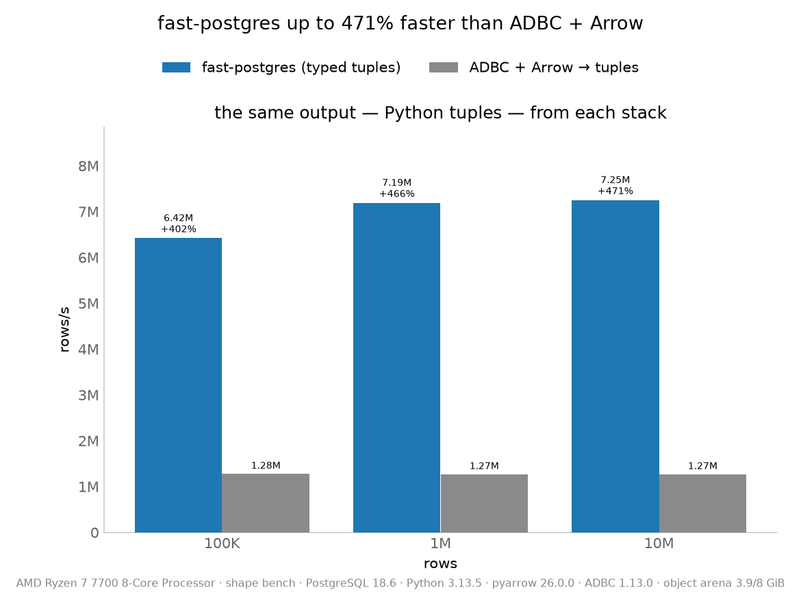
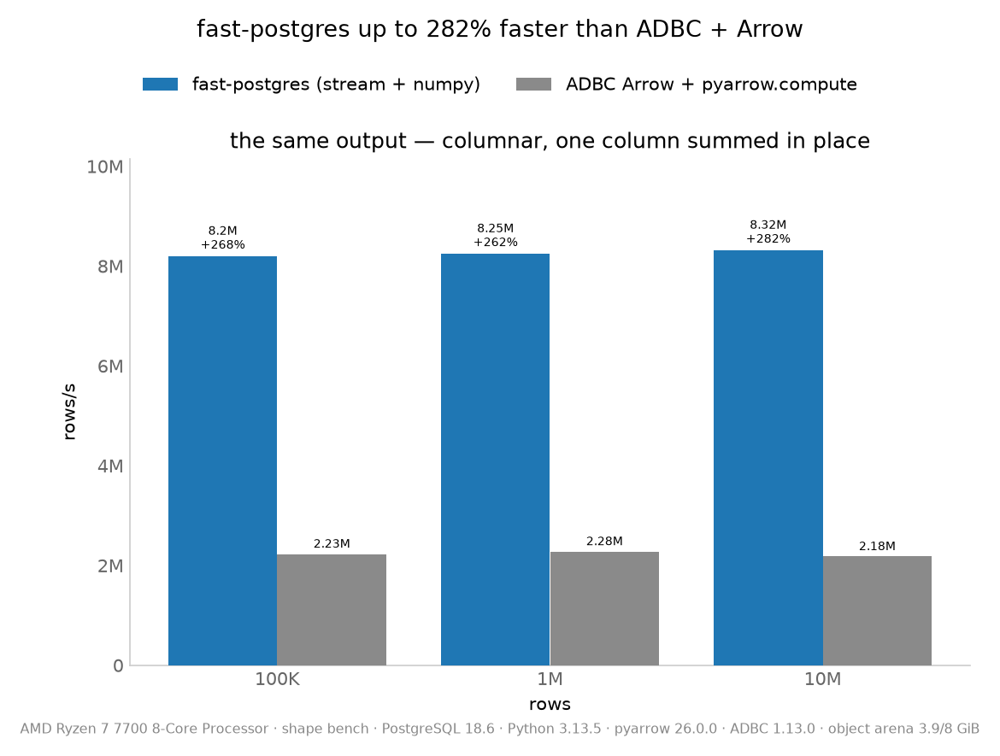
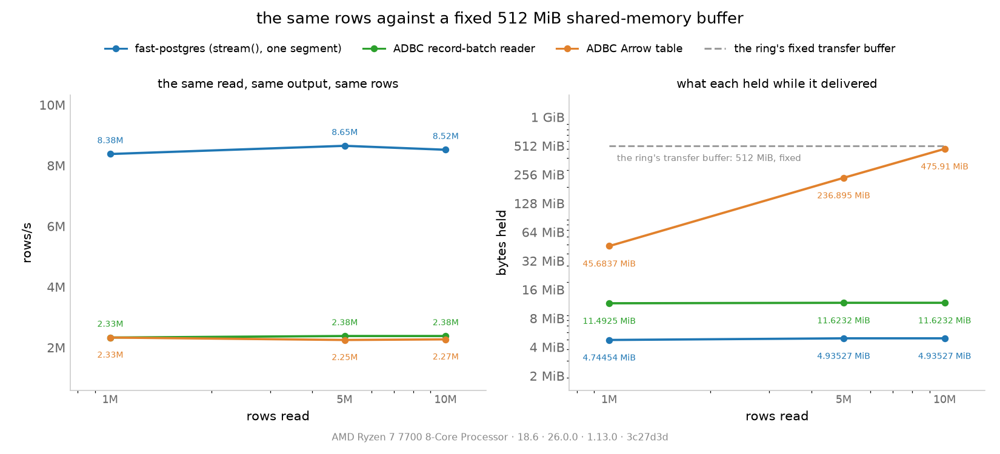
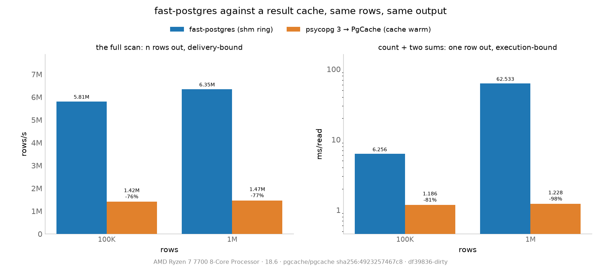

<div align="center">
  

  <h1>FastPostgres</h1>

  <p><strong>PostgreSQL query results delivered through POSIX shared memory as typed arrays, instead of the socket's text protocol.</strong></p>

  <p>
    <a href="https://www.postgresql.org/"></a>
    <a href="pg-extension/src/ring.h"></a>
    <a href="python-extension"></a>
    <a href="https://www.docker.com/"></a>
    <a href="./LICENSE"></a>
    <a href="docs/LIMITATIONS.md"></a>
  </p>

  <p>
    <a href="#measured-results"><strong>Results</strong></a> ·
    <a href="#quick-start"><strong>Quick Start</strong></a> ·
    <a href="DOCUMENTATION.md"><strong>Documentation</strong></a> ·
    <a href="docs/METHODOLOGY.md"><strong>Methodology</strong></a> ·
    <a href="docs/WHY-IT-WINS.md"><strong>Design notes</strong></a> ·
    <a href="docs/LIMITATIONS.md"><strong>Limitations</strong></a>
  </p>
</div>

---

Every PostgreSQL read crosses a socket, is serialized to text, and is parsed back into typed values in the client. FastPostgres removes that path for read-only `SELECT`s: a background worker runs the query with a portal and publishes every batch into `/dev/shm`, and the client maps the segment and reads it in place. The result tuples go out as the executor laid them out (one `memcpy` per row) or, for the zero-copy column views, as a columnar frame. Both formats, their readers and their writer live in one header, [`pg-extension/fastpostgres_shm.h`](pg-extension/fastpostgres_shm.h).

Writes, DDL and transactions keep using libpq, so a FastPostgres application is an ordinary PostgreSQL application with one URL changed.

> [!IMPORTANT]
> FastPostgres is a research prototype, not production software. It is Linux-only and same-host by construction (the transport is POSIX shared memory), and `/dev/shm/<seg>` is an SQL-execution endpoint. Read [`docs/LIMITATIONS.md`](docs/LIMITATIONS.md) before using it for anything real.

## Why FastPostgres

- **Nothing is parsed on the client.** The bytes the executor wrote are the bytes the client reads: no text encoding, no value parsing, no per-row Python object unless the caller wants one.
- **The executor's own tuples.** The row frame carries PostgreSQL's tuples as they lie, one `memcpy` per row, so every type the server can store can be sent; types whose storage is not the wire bytes take the columnar frame instead.
- **Zero-copy column views.** `stream()` hands back views over the segment's columns, so a sum, a filter or a conversion to numpy touches the shared memory in place.
- **One wire format, defined once.** Reader and writer share the same header, and the benchmark generator includes it too, so the format cannot drift between them.
- **Composes with a cache, does not compete with one.** A result cache removes execution on repeated queries; this removes delivery on every query. The two are measured against each other in [`docs/PG-CACHE.md`](docs/PG-CACHE.md).

## How it works

1. The client creates a ring segment in `/dev/shm` and initializes its semaphores, then bootstraps a background worker with one SQL call (`fastpostgres_ring_start`) over libpq.
2. The worker opens the query as a portal and, per request, fetches a batch and writes it into a data segment the request names - the row frame (`FPROWS`) or the columnar frame (`FPCOLUMN`).
3. The client maps the data segment read-only and decodes the batch in place. Requests and replies travel through the ring, so the read itself never touches a socket.
4. Two data segments alternate: the client posts the request for batch *n+1* before decoding batch *n*, which hides the worker's turn behind the decode.
5. Writes, DDL, `SET` and anything inside a transaction stay on libpq.

The extension's SQL surface is deliberately tiny: `fastpostgres_ring_start(text)` and `fastpostgres_ring_stop(text)`. Everything else runs inside the worker, off the ring.

## Measured results

All numbers below are from committed logs, on an AMD Ryzen 7 7700 (8 cores / 16 threads, 30 GiB RAM), in a Debian container on `postgres:18`, with `/dev/shm` at 3 GiB. Each player runs in a process of its own, one at a time, with a warm read before the timed ones; the protocol and its threats to validity are in [`docs/METHODOLOGY.md`](docs/METHODOLOGY.md).

### Read path: FastPostgres against ADBC + Arrow

The rival is the Arrow ecosystem's own answer to the same read - ADBC's PostgreSQL driver, whose results arrive as Arrow record batches - and each comparison asks both stacks for the same output.



| same output: Python tuples | 100K | 1M | 10M |
|---|---|---|---|
| FastPostgres (its DBAPI) | 6.42M | 7.19M | 7.25M |
| ADBC + Arrow, `to_pylist` | 1.28M | 1.27M | 1.27M |



| same output: the columnar form, one column summed in place | 100K | 1M | 10M |
|---|---|---|---|
| FastPostgres `stream()` + numpy | 8.20M | 8.25M | 8.32M |
| ADBC Arrow + `pyarrow.compute` | 2.23M | 2.28M | 2.18M |

That is **5.0-5.7x faster when both build Python tuples** and **3.6-3.8x faster when both consume columnar**. The shm bytes are read where they landed, while ADBC converts the wire data into Arrow buffers first - and, for tuples, converts a second time into Python objects. Comparing FastPostgres's tuples against ADBC's Arrow table would price those two different outputs, not the two transports, which is why neither table above does it.

The ranking survives a harder shape. With `SHAPE=mixed` - NULLs on ~10% of the values, text on both sides of the 126-byte varlena split, a non-ASCII value every eighth row - the same two comparisons read **4.7-6.0x** and **4.1-4.3x**: the data slows FastPostgres ~13% and ADBC ~18%, so the ratio holds.

`just bench` also prints the rest of what FastPostgres does with those rows, against its own driver read:

| path (1M rows, `bench` shape) | vs the plain driver read |
|---|---|
| `stream()` + numpy sum | +13-21% |
| `fastpostgres.core` (the lean interface) | level with the DBAPI |
| four processes, DBAPI | +84-94% aggregate at 100K/1M, +21% at 10M (the ring pool and memory bandwidth saturate) |
| the same read through SQLAlchemy CORE | -72-83% (SQLAlchemy's `Row` construction, ~570 ns/row, not the transport) |
| ADBC Arrow + sum, for reference | -65-69% |

### What each side holds: against Arrow under a fixed buffer

Speed is half of the comparison; memory is the other half. With the ring's transfer buffer fixed at 512 MiB - a quarter of its default - the same reads report what each side carried ([`docs/ARROW-MEMORY.md`](docs/ARROW-MEMORY.md), [`log`](docs/fastpostgres-vs-arrow-memory.log)):

| 1M / 5M / 10M rows | rows/s | held while it delivers |
|---|---|---|
| FastPostgres `stream()`, one 512 MiB segment | **9.54M / 8.90M / 8.82M** | 512 MiB reserved, ~4.9 MiB in flight per 100k-row batch, flat ~143 MiB RSS |
| ADBC record-batch reader | 2.38M / 2.38M / 2.38M | one 11.6 MiB Arrow batch, 168-172 MiB RSS |
| ADBC Arrow table | 2.32M / 2.32M / 2.32M | the whole result: 45.7 / 236.9 / **475.9 MiB**, 192-640 MiB RSS |

A transfer buffer is a window: the ring's is the same 512 MiB whatever the result's size. A table is a working set: at 10M rows ADBC's holds ~476 MiB at once, one size up from the buffer the ring ever spends.



> [!NOTE]
> Small results are the exception to the ranking: at 1K rows the plain driver read wins and the columnar path's fixed costs dominate. The numbers and the reason are in [`docs/LIMITATIONS.md`](docs/LIMITATIONS.md#small-results-where-the-rankings-invert).

### Result caches: PgCache

A result cache removes *execution* on repeated queries; this removes *delivery* on every query, so they win different shapes. The rival is PgCache, a CDC-maintained result cache in front of the same server, with its defaults ([`docs/PG-CACHE.md`](docs/PG-CACHE.md), [`log`](docs/fastpostgres-vs-pgcache.log)):



| 1M rows, the same rows out | FastPostgres | PgCache (hit) |
|---|---|---|
| the full scan, rows/s | **6.35M** | 1.47M |
| count/sums, ms/read | 62.533 | **1.228** |

A cached aggregate is 51x faster than reading the same rows directly: the executor is the cost, and no transport closes that. A cached large result is the other way round - 4.3x slower than the ring - and a hit costs what its cold fill costs, because a hit still ships every row through the socket and rebuilds every Python object.

Given the **same memory budget on both sides** - the ring's transfer buffer and the cache's own memory, one `M` - the ranking holds where the cache fits at all: at 1 GiB, the 1M-row scan is 6.53M rows/s against the cache's 1.47M, and the aggregate 1.117 ms against 55.776 ms. The ring's numbers are flat from an 8 MiB budget up, while the cache's container is OOM-killed below ~256 MiB and its registration is throttled to nothing at 256 MiB ([`section`](docs/PG-CACHE.md#the-same-memory-budget-on-both-sides), [`log`](docs/fastpostgres-vs-pgcache-memory.log)).


## Quick start

Requirements: a Linux host with `/dev/shm`, Docker and [`just`](https://github.com/casey/just). Everything runs in the dev image, which builds the extension, the client and the benchmark harnesses.

```bash
git clone https://github.com/carlosdaniel26/fastpostgres.git
cd fastpostgres

just test          # the Python client's test suite
just bench         # FastPostgres vs ADBC + Arrow, 100K / 1M / 10M rows
just demo 5000     # the same app on psycopg 3 and on FastPostgres
```

Each command starts a throwaway PostgreSQL with the extension, runs, and exits. No service is left behind; no benchmark writes to your database.

### Benchmarks and meters

| command | what it measures | record |
|---|---|---|
| `just bench [nrows...]` | the read against ADBC + Arrow, and the paths inside FastPostgres | [`fastpostgres-vs-arrow.log`](docs/fastpostgres-vs-arrow.log), [`-mixed`](docs/fastpostgres-vs-arrow-mixed.log), [`-small`](docs/fastpostgres-vs-arrow-small.log) |
| `just arrow-memory-bench [--mib=N]` | what each side holds under a fixed ring buffer | [`fastpostgres-vs-arrow-memory.log`](docs/fastpostgres-vs-arrow-memory.log) |
| `just pgcache-bench` | against a CDC-maintained result cache | [`fastpostgres-vs-pgcache.log`](docs/fastpostgres-vs-pgcache.log) |
| `just pgcache-memory-bench` | the same, with one memory budget on both sides | [`fastpostgres-vs-pgcache-memory.log`](docs/fastpostgres-vs-pgcache-memory.log) |
| `just codec-transport` | format cost against transport cost, isolated (2x2 matrix) | [`codec-transport.log`](docs/codec-transport.log) |
| `just decode-cycles`, `just decode-ir`, `just decode-mca` | the row decode's cycles per row, instructions and miss profile, ports and latency | [`simd/hypotheses.md`](simd/hypotheses.md) |
| `just cache-stat` | cache counters on the host's PMU: decodes per row, transports per KiB | [`cache-stat.log`](docs/cache-stat.log) |

`just charts`, `just codec-charts`, `just pgcache-charts`, `just pgcache-memory-charts` and `just arrow-memory-charts` render the corresponding logs into images under `assets/`. The harnesses read two host-side settings: `SHM` for the container's `/dev/shm` size (default `3g`) and `SHAPE` for the data shape (`bench`, the friendly one, or `mixed`).

## Usage

Any SQLAlchemy application, unchanged apart from the URL:

```python
import fastpostgres.dialect  # registers postgresql+fastpostgres
engine = create_engine("postgresql+fastpostgres://user@/app?host=/tmp")
```

Or the driver directly, as a PEP 249 module:

```python
import fastpostgres.dbapi as dbapi

conn = dbapi.connect("host=/tmp dbname=app user=app")
rows = conn.cursor().execute("select id, name from products").fetchall()
```

For the zero-copy path, iterate the columnar batches and reduce them in place:

```python
cur = conn.cursor()
for batch in cur.stream("select id, price from products"):
    prices = np.frombuffer(batch.columns[1].data, dtype="<f8")
    total = prices.sum()          # views alias the segment: use, or copy, before the next batch
```

Read-only `SELECT`s take the ring; everything else goes over libpq. The `demo/` application is the same SQLAlchemy app run on psycopg 3 and on FastPostgres, to show what the URL change does.

## Configuration

| variable | default | effect |
|---|---|---|
| `FASTPOSTGRES_SHM_POOL` | sized from the machine and the server, at most 8 | how many rings (each one background worker) a process may create. `0` turns the shared-memory path off and every read stays on libpq |
| `FASTPOSTGRES_SEGMENT_BYTES` | 1 GiB | capacity of each data segment, in bytes; clamped to 64 KiB - 1 GiB. A stream alternates two of them |
| `FASTPOSTGRES_OBJ_ARENA` | half the cgroup limit, at most 8 GiB | arena for the Python objects a tuple read builds; `0` uses the normal constructors |

On the server side, `max_worker_processes` bounds how many rings (background workers) can exist at once; when the budget is exhausted a read falls back to libpq and the client warns once.

## Documentation

Project layout, the documentation index, the known limitations, contributing, and the license are in [`DOCUMENTATION.md`](DOCUMENTATION.md).
