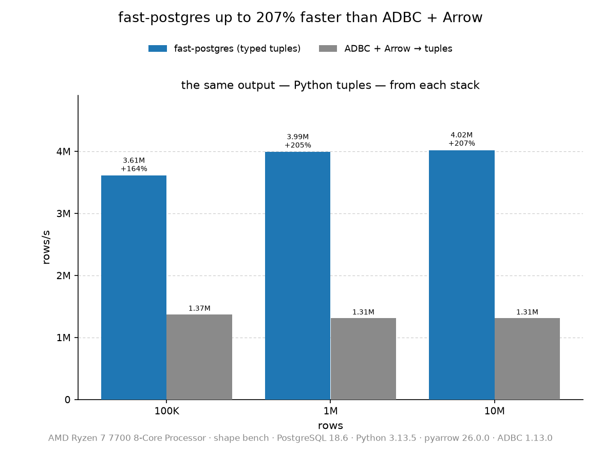
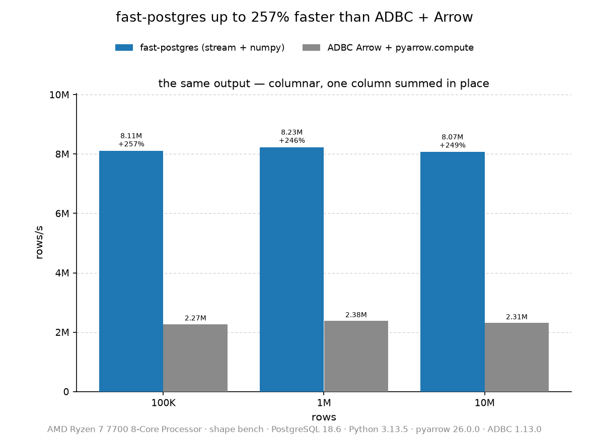
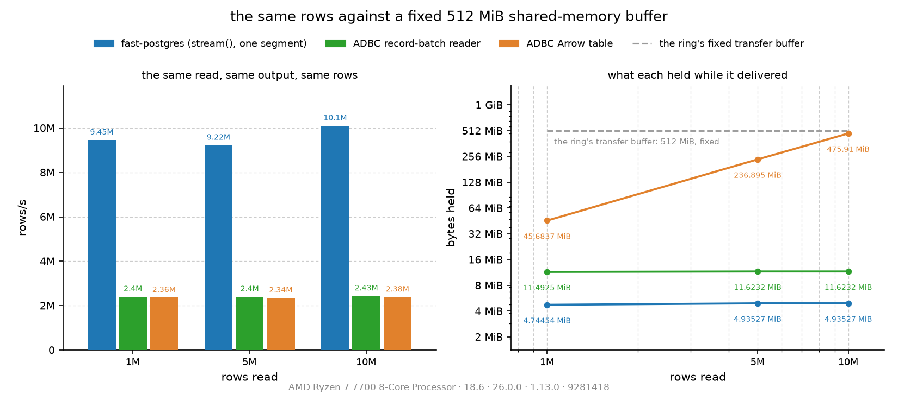
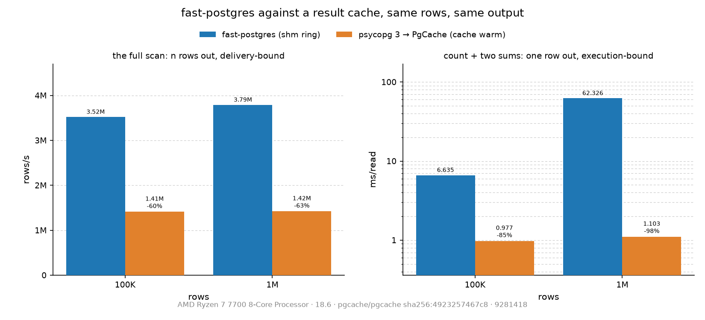
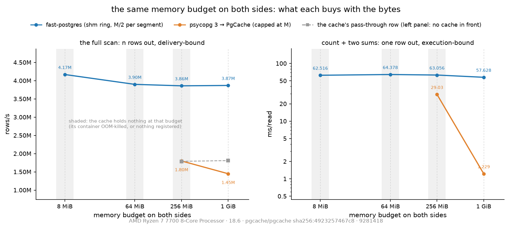

<div align="center">
  

  <h1>FastPostgres</h1>

  <p><strong>PostgreSQL query results delivered through POSIX shared memory as typed arrays, instead of the socket's text protocol.</strong></p>

  <p>
    <a href="https://www.postgresql.org/"></a>
    <a href="extension/include/fastpostgres/ring.h"></a>
    <a href="python"></a>
    <a href="https://www.docker.com/"></a>
    <a href="./LICENSE"></a>
    <a href="docs/LIMITATIONS.md"></a>
  </p>

  <p>
    <a href="#measured-results"><strong>Results</strong></a> ·
    <a href="#where-it-loses"><strong>Where it loses</strong></a> ·
    <a href="#quick-start"><strong>Quick Start</strong></a> ·
    <a href="bench/README.md"><strong>Benchmarks</strong></a> ·
    <a href="DOCUMENTATION.md"><strong>Documentation</strong></a> ·
    <a href="bench/METHODOLOGY.md"><strong>Methodology</strong></a> ·
    <a href="docs/LIMITATIONS.md"><strong>Limitations</strong></a>
  </p>
</div>

---

Every PostgreSQL read crosses a socket, is serialized to text, and is parsed back into typed values in the client. FastPostgres removes that path for read-only `SELECT`s: a background worker runs the query with a portal and publishes every batch into `/dev/shm`, and the client maps the segment and reads it in place. The result tuples go out as the executor laid them out (one `memcpy` per row) or, for the zero-copy column views, as a columnar frame. Both formats, their readers and their writer live in one header, [`extension/include/fastpostgres/fastpostgres_shm.h`](extension/include/fastpostgres/fastpostgres_shm.h).

Writes, DDL and transactions keep using libpq, so a FastPostgres application is an ordinary PostgreSQL application with one URL changed.

> [!IMPORTANT]
> FastPostgres is a research prototype, not production software. It is Linux-only and same-host by construction (the transport is POSIX shared memory), and `/dev/shm/<seg>` is an SQL-execution endpoint. Read [`docs/LIMITATIONS.md`](docs/LIMITATIONS.md) before using it for anything real.

## Why FastPostgres

- **Nothing is parsed on the client, and the ratio says so.** The bytes the executor wrote are the bytes the client reads: no text encoding, no value parsing, no per-row Python object unless the caller wants one. Where both stacks are asked for the same Python tuples, that is 2.6-3.0x ADBC + Arrow, at 100K, 1M and 10M rows.
- **The executor's own tuples.** The row frame carries PostgreSQL's tuples as they lie, one `memcpy` per row, so every type the server can store can be sent; types whose storage is not the wire bytes take the columnar frame instead.
- **Zero-copy column views.** `stream()` hands back views over the segment's columns, so a sum, a filter or a conversion to numpy touches the shared memory in place: 3.5-3.6x Arrow's `pyarrow.compute` over its own table, on the same column.
- **One wire format, defined once.** Reader and writer share the same header, and the benchmark generator includes it too, so the format cannot drift between them.
- **Composes with a cache, does not compete with one.** A result cache removes execution on repeated queries; this removes delivery on every query. A cached aggregate beats reading the same rows 56x, and the ring beats a cached large result 2.7x; the two are measured against each other in [`bench/PG-CACHE.md`](bench/PG-CACHE.md).
- **One URL.** No new query language, no annotation, no client rewrite: the same SQLAlchemy application, on a driver whose reads take a different road.

## How it works

1. The client creates a ring segment in `/dev/shm` and initializes its semaphores, then bootstraps a background worker with one SQL call (`fastpostgres_ring_start`) over libpq.
2. The worker opens the query as a portal and, per request, fetches a batch and writes it into a data segment the request names - the row frame (`FPROWS`) or the columnar frame (`FPCOLUMN`).
3. The client maps the data segment read-only and decodes the batch in place. Requests and replies travel through the ring, so the read itself never touches a socket.
4. Two data segments alternate: the client posts the request for batch *n+1* before decoding batch *n*, which hides the worker's turn behind the decode.
5. Writes, DDL, `SET` and anything inside a transaction stay on libpq.

The extension's SQL surface is deliberately tiny: `fastpostgres_ring_start(text)` and `fastpostgres_ring_stop(text)`. Everything else runs inside the worker, off the ring.

## The two read paths

A read takes one of two roads, and the choice is which cost dominates:

- **Tuples** — `fetchall()`, the DBAPI default. The worker writes the row frame
  (`FPROWS`, the executor's own tuple bytes) and the client walks it in place,
  building a Python object per value: no setup cost, a per-row cost.
- **Zero-copy** — `stream()`. The worker writes the columnar frame (`FPCOLUMN`)
  and the client returns `memoryview`s over the segment: a fixed cost to open
  the stream and map it, then nothing per row.

The fixed cost is what makes the small end flip: at 1K rows `stream()` already
wins, while the `core` interface and process fan-out — the same work with extra
machinery — lose to a plain `fetchall`, because their fixed costs dominate a
result that small. Pick `stream()` to reduce columns in place, `fetchall()` for
plain rows.

## Measured results

All numbers below are from committed logs, on an AMD Ryzen 7 7700 (8 cores / 16 threads, 30 GiB RAM), in a Debian container on `postgres:18`, with `/dev/shm` at 3 GiB. Each player runs in a process of its own, one at a time, with a warm read before the timed ones; the protocol and its threats to validity are in [`bench/METHODOLOGY.md`](bench/METHODOLOGY.md), and every record is indexed in [`bench/RESULTS.md`](bench/RESULTS.md).

### Where it loses

Read this before the ratios above: the losses are as measured as the wins, and
they are what decides whether this belongs in an application.

| where | the number | why |
|---|---|---|
| `SELECT 1+1`, 10 connections, a published suite | 41.0K queries/s against asyncpg's 85.1K | one row per statement: a stream opened and closed, against a prepared pipeline ([`bench/ADOPTION.md`](bench/ADOPTION.md)) |
| a 1000-row batched `INSERT` | 5.4/s against asyncpg's 885 | the client's libpq DML path, one row at a time; the ring is not involved |
| `COPY` | not supported | writes are libpq, and the client has no COPY call there |

### Read path: FastPostgres against ADBC + Arrow

The rival is the Arrow ecosystem's own answer to the same read - ADBC's PostgreSQL driver, whose results arrive as Arrow record batches - and each comparison asks both stacks for the same output.



| same output: Python tuples | 100K | 1M | 10M |
|---|---|---|---|
| FastPostgres (its DBAPI) | 3.61M | 3.99M | 4.02M |
| ADBC + Arrow, `to_pylist` | 1.37M | 1.31M | 1.31M |



| same output: the columnar form, one column summed in place | 100K | 1M | 10M |
|---|---|---|---|
| FastPostgres `stream()` + numpy | 8.11M | 8.23M | 8.07M |
| ADBC Arrow + `pyarrow.compute` | 2.27M | 2.38M | 2.31M |

That is **2.6-3.0x faster when both build Python tuples** and **3.5-3.6x faster when both consume columnar**. The shm bytes are read where they landed, while ADBC converts the wire data into Arrow buffers first - and, for tuples, converts a second time into Python objects. Comparing FastPostgres's tuples against ADBC's Arrow table would price those two different outputs, not the two transports, which is why neither table above does it.

The ranking survives a harder shape. With `SHAPE=mixed` - NULLs on ~10% of the values, text on both sides of the 126-byte varlena split, a non-ASCII value every eighth row - the same two comparisons read **2.9-3.2x** and **3.3-3.5x**: the data slows FastPostgres ~13% and ADBC ~18%, so the ratio holds.

The same read also reports the rest of what FastPostgres does with its rows, against its own driver read:

| path (1M rows, `bench` shape) | vs the plain driver read |
|---|---|
| `stream()` + numpy sum | +111-114% |
| `fastpostgres.core` (the lean interface) | level with the DBAPI |
| four processes, DBAPI | +132-140% aggregate (the ring pool and memory bandwidth saturate) |
| ADBC Arrow + sum, for reference | -36-41% |

### What each side holds: against Arrow under a fixed buffer

Speed is half of the comparison; memory is the other half. With the ring's transfer buffer fixed at 512 MiB - a quarter of its default - the same reads report what each side carried ([`bench/ARROW-MEMORY.md`](bench/ARROW-MEMORY.md), [`log`](bench/results/fastpostgres-vs-arrow-memory.log)):

| 1M / 5M / 10M rows | rows/s | held while it delivers |
|---|---|---|
| FastPostgres `stream()`, one 512 MiB segment | **9.45M / 9.22M / 10.10M** | 512 MiB reserved, ~4.9 MiB in flight per 100k-row batch, flat ~138 MiB RSS |
| ADBC record-batch reader | 2.40M / 2.40M / 2.43M | one 11.6 MiB Arrow batch, 161-165 MiB RSS |
| ADBC Arrow table | 2.36M / 2.34M / 2.38M | the whole result: 45.7 / 236.9 / **475.9 MiB**, 183-658 MiB RSS |

A transfer buffer is a window: the ring's is the same 512 MiB whatever the result's size. A table is a working set: at 10M rows ADBC's holds ~476 MiB at once, one size up from the buffer the ring ever spends.



### Result caches: PgCache

A result cache removes *execution* on repeated queries; this removes *delivery* on every query, so they win different shapes. The rival is PgCache, a CDC-maintained result cache in front of the same server, with its defaults ([`bench/PG-CACHE.md`](bench/PG-CACHE.md), [`log`](bench/results/fastpostgres-vs-pgcache.log)):



| 1M rows, the same rows out | FastPostgres | PgCache (hit) |
|---|---|---|
| the full scan, rows/s | **3.79M** | 1.42M |
| count/sums, ms/read | 62.326 | **1.103** |

A cached aggregate is 56x faster than reading the same rows directly: the executor is the cost, and no transport closes that. A cached large result is the other way round - 2.7x slower than the ring - and a hit costs what its cold fill costs, because a hit still ships every row through the socket and rebuilds every Python object.

Given the **same memory budget on both sides** - the ring's transfer buffer and the cache's own memory, one `M` - the ranking holds where the cache fits at all: at 1 GiB, the 1M-row scan is 3.87M rows/s against the cache's 1.45M, and the aggregate 1.229 ms cached against 57.628 ms read. The ring's numbers are flat from an 8 MiB budget up, while the cache's container is OOM-killed at 8 MiB and 64 MiB ([`section`](bench/PG-CACHE.md#the-same-memory-budget-on-both-sides), [`log`](bench/results/fastpostgres-vs-pgcache-memory.log)).



### A published suite's own terms

The fourth class runs somebody else's benchmark, on its own protocol, with
FastPostgres added to its roster as one more cell: MagicStack's pgbench, the
PostgreSQL driver toolbench behind asyncpg's documentation, vendored at a pinned
commit. Seven queries over which the ring wins the reads with structure in them
(`int[]` 2.8x asyncpg, `generate_series` 1.72x), loses the one-row statement
(41.0K against 85.1K) and the batched `INSERT` (5.4 against 885, and that cell is
the client's libpq path), and cannot run `COPY` at all. The full table, the
method and every adaptation the suite needed are in
[`bench/ADOPTION.md`](bench/ADOPTION.md).

## Quick start

Requirements: a Linux host with `/dev/shm`, Docker and [`just`](https://github.com/casey/just). Everything runs in the dev image, which builds the extension, the client and the benchmark harnesses.

```bash
git clone https://github.com/carlosdaniel26/fastpostgres.git
cd fastpostgres

just test          # the extension's SQL surface and the client's test suite
just rivals adbc   # FastPostgres vs ADBC + Arrow, 100K / 1M / 10M rows
just adoption magicstack-pgbench   # somebody else's suite, our cell in its roster
just demo 5000     # the same app on psycopg 3 and on FastPostgres
```

Each command starts a throwaway PostgreSQL with the extension, runs, and exits. No service is left behind; no benchmark writes to your database.

### Benchmarks and meters

| class | command | what it answers |
|---|---|---|
| rivals | `just rivals [adbc\|arrow-memory\|cache\|cache-budget]` | how the ring compares with ADBC + Arrow and with a result cache, at their defaults and under a fixed memory budget |
| internals | `just internals [decode-cycles\|decode-ir\|decode-mca\|codec-transport\|cache-stat]` | what the row decode and the transport cost at the instruction, cache and port level |
| adoption | `just adoption [magicstack-pgbench]` | what a published third-party suite's own queries and protocol find, with our cell in its roster |

The full catalog - the scenarios, the method, the log behind every number and the
caveats - is [`bench/README.md`](bench/README.md); `just charts <target>`
renders any of the logs into an image under `docs/assets/`. The harnesses read two
host-side settings: `SHM` for the container's `/dev/shm` size (default `3g`) and
`SHAPE` for the data shape (`bench`, the friendly one, or `mixed`).

## Usage

Any SQLAlchemy application, unchanged apart from the URL:

```python
import fastpostgres.dialect  # registers postgresql+fastpostgres
engine = create_engine("postgresql+fastpostgres://user@/app?host=/tmp")
```

Or the driver directly, as a PEP 249 module:

```python
import fastpostgres.dbapi as dbapi

conn = dbapi.connect("host=/tmp dbname=app user=app")
rows = conn.cursor().execute("select id, name from products").fetchall()
```

For the zero-copy path, iterate the columnar batches and reduce them in place:

```python
cur = conn.cursor()
for batch in cur.stream("select id, price from products"):
    prices = np.frombuffer(batch.columns[1].data, dtype="<f8")
    total = prices.sum()          # views alias the segment: use, or copy, before the next batch
```

Read-only `SELECT`s take the ring; everything else goes over libpq. The `examples/` application is the same SQLAlchemy app run on psycopg 3 and on FastPostgres, to show what the URL change does.

## Configuration

| variable | default | effect |
|---|---|---|
| `FASTPOSTGRES_SHM_POOL` | sized from the machine and the server, at most 8 | how many rings (each one background worker) a process may create. `0` turns the shared-memory path off and every read stays on libpq |
| `FASTPOSTGRES_SEGMENT_BYTES` | 1 GiB | capacity of each data segment, in bytes; clamped to 64 KiB - 1 GiB. A stream alternates two of them |

On the server side, `max_worker_processes` bounds how many rings (background workers) can exist at once; when the budget is exhausted a read falls back to libpq and the client warns once.

## Status

- **A research prototype.** Linux, same host, single writer's discretion: see [`docs/LIMITATIONS.md`](docs/LIMITATIONS.md) for the list, including the ones that shape how it can be used at all.
- **Tested**: the extension's SQL surface under `pg_regress`, and 29 client tests covering the wire types, the ring pool, fork safety and the libpq fallbacks; CI runs both, plus ruff, shellcheck and the markdown link check.
- **Not here yet**: an async client, COPY, a network transport, and any platform but Linux. Writes, DDL and transactions are libpq's, deliberately.

## How this was built

FastPostgres is built with an AI coding assistant, from a human design: the
transport - a background worker publishing batches into shared memory, the two
frames, the ring, the engine choice - is the design, and the implementation, the
harnesses, the charts and most of this documentation were written in pairing
sessions with it. The commit history and the notebook
([`bench/NOTES.md`](bench/NOTES.md)) are the record of how the numbers moved,
including the hypotheses that were falsified.

That is also why the measurement discipline here is what it is. Every number
quoted on this page is a line in a committed log, produced by a command you can
run, stamped with the commit it came from; two of the four classes measure
somebody else's protocol or somebody else's stack, on purpose, so that not all
of the evidence is ours.

## Documentation

Project layout, the documentation index, the known limitations, contributing,
and the license are in [`DOCUMENTATION.md`](DOCUMENTATION.md); the claim's own
tree - the classes, the records, the arguments they back - starts at
[`bench/README.md`](bench/README.md).
