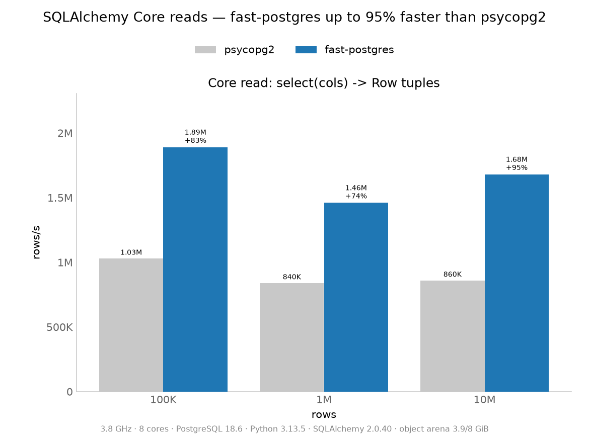

<p align="center"></p>

# FastPostgres

PostgreSQL query results delivered through POSIX shared memory as columnar
typed arrays, instead of the socket's text protocol. A background worker runs
each read with an SPI cursor and publishes batches as `FPCOLUMN` payloads in
`/dev/shm`; the client maps the segment and reads the columns in place. Writes,
DDL and transactions keep using libpq. The format, its reader and its writer
live in one header, `pg-extension/fastpostgres_shm.h`.

## Measured



8-core container, PostgreSQL 18.6. Reads run ~6× the socket transports
(≈7.5M vs ≈1.2M rows/s) and writes ~2.5×. Once rows become Python objects, the
Core path lands 17–34% ahead of psycopg2 and the ORM 5–13%, because
materialising and hydrating objects is allocation-bound.

## Usage

Any SQLAlchemy app, unchanged apart from the URL:

```python
import fastpostgres.dialect  # registers postgresql+fastpostgres
engine = create_engine("postgresql+fastpostgres://user@/app?host=/tmp")
```

Or the driver directly, as a PEP 249 module:

```python
import fastpostgres.dbapi as dbapi

conn = dbapi.connect("host=/tmp dbname=app user=app")
rows = conn.cursor().execute("select id, name from products").fetchall()
```

Read-only `SELECT`s take the ring; everything else goes over libpq. Build and
run with Docker and `just` (Linux host with `/dev/shm`):

```bash
just test          # client test suite
just demo 5000     # the same app on psycopg2 and fastpostgres
just charts        # benchmarks + charts
```

Known limits: ring reads run in the worker's session, so they miss the calling
connection's uncommitted writes (the driver is autocommit); `numeric` widens to
`float8` on the wire; a ring serves one stream at a time, with at most
`FASTPOSTGRES_SHM_POOL` (default 4) per process; `/dev/shm/<seg>` is mode 0600
and the ring is an SQL-execution endpoint, so it is not for production.
