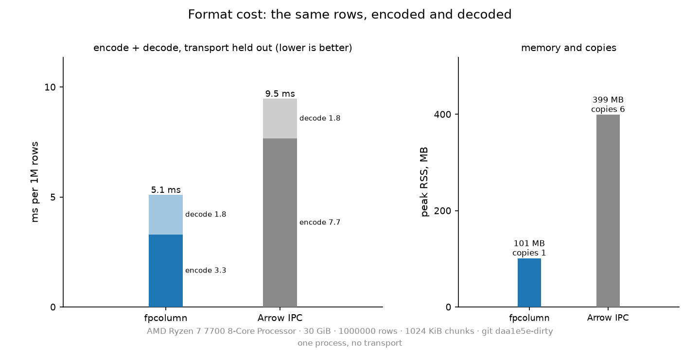
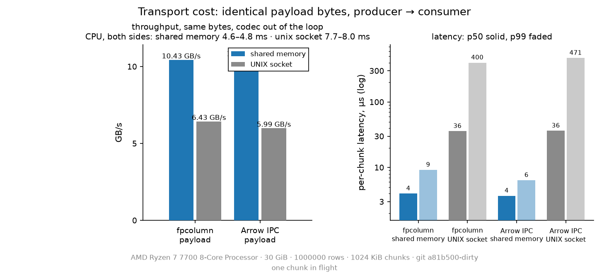
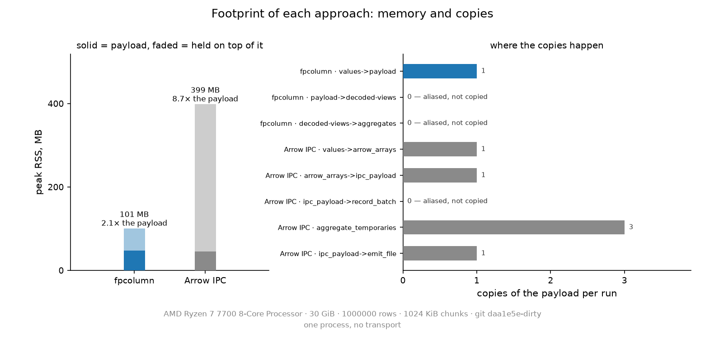
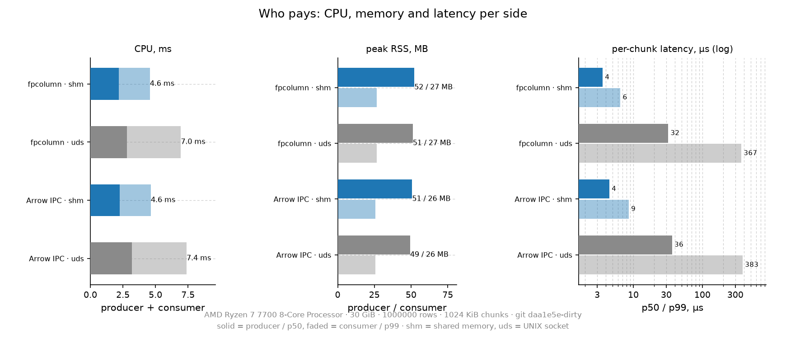

# Codec + transport isolation

Two experiments, four cells, one runner, and no PostgreSQL in the loop. The
question is what the **wire format** costs and what the **transport** costs,
measured apart so neither can hide behind the other. The contract every cell
implements is [`bench/internals/codec_transport/SPEC.md`](internals/codec_transport/SPEC.md);
the runner is
[`bench/internals/codec_transport/run_matrix.py`](internals/codec_transport/run_matrix.py);
the measured record is [`codec-transport.log`](results/codec-transport.log), written by
the runner and committed with the run's `git:` stamp.

Nothing here connects to PostgreSQL. The point of leaving the server out is
that in the real path the worker encodes, the ring moves the bytes and the
client decodes — three costs that a query-level benchmark can only measure
together. The matrix prices the codec and the transport separately, on identical
bytes, so the two factors cannot absorb each other's time.

## The two experiments as a 2x2

| | transport held out (Experiment 1, in process) | `shm` | `uds` |
|---|---|---|---|
| `fpcolumn` | encode → bytes → decode + aggregates | the emitted payload over shm | the emitted payload over uds |
| `arrow-ipc` | encode → bytes → decode + aggregates | the emitted payload over shm | the emitted payload over uds |

- **Experiment 1 (format):** the two columnar formats run in one process, no
  transport. Each cell encodes the dataset, emits the payload to a file, decodes
  the payload and computes the six aggregates. `--reps 3`, median reported.
- **Experiment 2 (transport):** the payloads Experiment 1 emitted are moved
  producer → consumer, unchanged, over each transport. The codec is not in the
  loop; the file *is* the payload. The runner runs {fpcolumn, arrow-ipc} ×
  {shm, uds}, one cell at a time.

**Held constant:** the dataset generator and its row order, the five-number
checksum, the timed operation (decode to the natural form + six aggregates, in
native code on both sides), one process per codec cell, one producer and one
consumer per transport cell, the chunk size (1 MiB), the dev image and the
host, and — the one that matters most — one measurement at a time.

**Why the format cells leave the transport out.** The format's cost is the work
it does to its own bytes: build the columns, serialize, parse, aggregate. Put a
socket or a shared segment in the middle and the ranking becomes a function of
the pipe's frame handling as much as of the format: a format that is slower to
encode can win the round trip because its bytes happen to suit the transport's
chunking. Keeping the transport out gives the format comparison a clean
denominator: the same process, the same rows, the same aggregates, only the
frame changes.

**Why the transport cells leave the codec out.** The codec's cost is already
measured in Experiment 1, and the codec is exactly what is *not* in question
when comparing transports. Two different payload streams (one per format) are
each moved through the *same* consumer loop, so each transport row is measured
on identical bytes — the file the codec already produced. If encode ran inside
the transport cell, a slow codec would dilute a transport difference (and vice
versa) and the four cells would no longer be four transports of the same bytes.

The two experiments deliberately do not overlap in time: the 2x2's corner — a
codec encoding *while* a transport runs — is not measured. In a real deployment
that overlap exists (producer and consumer are separate processes), but timing
it here would be timing the machine, not the factors; the matrix measures the
two terms and leaves the overlap to the ring's own benchmarks.

## Dataset and timed region

Restated from [`SPEC.md`](internals/codec_transport/SPEC.md), because the
whole comparison rests on it: `--rows N` (default 1,000,000) generated in
memory, deterministic, `g = 1..N`, six columns (`id` int32, `sku`/`name` utf8,
`price` float64, `stock` int32, `active` bool). Every cell decodes the payload
into its natural in-memory form and computes the same six aggregates: rows,
Σid, Σstock, Σprice, count(active), Σ len(text bytes). No per-value Python
object is built in any cell. The full logical checksum — `sum_id`, `sum_stock`,
`sum_price_bits`, `trues`, `text_hash` — is computed once, outside the timed
region, from the decoded values; it exists to prove the cells carried the same
data, not to be measured.

## Metrics

The runner prints what the units reported and times nothing itself. These
definitions are the contract; where a cell has a choice it states its basis in
its own JSON (the Arrow cell's `throughput_basis`, the units' `breakdown` and
`runs` blocks), and the raw JSON lines in the log are the source of truth.

| field | meaning |
|---|---|
| `rows_per_s` | rows the cell carried per second of its timed region. |
| `gb_per_s` | **payload bytes** per second of the same region: bytes ÷ seconds ÷ 10^9. Not rows, not values, not Arrow buffers — the payload is the thing the transport also moves, so it is the one size both experiments share. |
| `encode_ms`, `decode_ms` | the two halves of the round trip, split as each cell defines them: building the in-memory columns and writing the payload; reading the payload, decoding and aggregating. The rates above use the cell's stated basis (the Arrow cell divides by the whole encode+decode rep); `encode_ms + decode_ms` is the round trip the runner's table implies. |
| `p50_ms`, `p99_ms` | the cell's latency distribution over its own units: per rep for the format cells (so with `--reps 3` a p99 is just the slowest of three), **per chunk** for the transport cells. In the transport cells a sample is one chunk's consumer-`received` time minus the producer's `published` time for that chunk, `CLOCK_MONOTONIC` on both sides (system-wide, so the two processes' stamps are comparable). p50 is the typical chunk; p99 is the tail where scheduling and page faults live. |
| `cpu_user_ms`, `cpu_sys_ms` | CPU actually consumed — user and system time — summed over *both* processes of the cell. The transport cells also report `producer_cpu_ms` / `consumer_cpu_ms`, so "CPU per side" is visible; user time is the copying/parsing work, system time the syscalls (mmap, `sendmsg`/`recvmsg`, `shm` state changes). A cell whose CPU total exceeds the wall time for the same work had the two sides running at once; one that uses less CPU than bytes moved is relying on the kernel's bulk paths. |
| `rss_kb` | the cell's resident set size (maximum over the process(es), as reported). For shm this counts the pages of the segment that were actually touched; for uds the buffers the kernel copied through. RSS is a footprint reading, not a rate: the payload itself dominates it, and shared/mapped pages are counted per process, so it is not a summable "memory cost". |
| `copies`, `copy_stages` | how many times payload bytes were explicitly moved, and at which stage. Per payload, not per row. The stages are the cell's own names, and the cell's `copy_stage_notes` says what each one counts. |
| `payload_bytes` | the frame's size in bytes: the codec's output and the transport's input. The runner compares it with the bytes of the emitted file when the transport cells run. |
| `chunks`, `chunk_bytes` | the transport's accounting: number of chunks and the bytes per chunk. The runner checks that the product covers `payload_bytes` before reporting anything (the two accepted conventions are under "What the runner validates"). |
| `checksum` | the five logical sums above, computed from decoded values outside the timed region. Identical in every format cell — and in any transport cell that reports one — or the run is invalid; the transport cells report a payload fold instead. |

### What each copy count means

A copy is one pass over the payload's bytes into somewhere else. A **0** is a
claim the cell has to demonstrate (by aliasing, mmap or reading in place), not a
promise — the SPEC is explicit that zero-copy is shown by not copying. The
stage names differ between cells, but they mean the same four things, plus
inside-the-timed-region temporaries:

| stage (examples) | what it counts |
|---|---|
| `values->frame`, `values->arrow_arrays`, `values->buffer` | building the payload from the in-memory columns. 0 here means the payload aliases the source arrays; in this dataset Arrow can wrap `id`/`price`/`stock` and fill the utf8 buffers in place, but `active` must be repacked into Arrow's bitmap (numpy bool is 1 byte, Arrow is 1 bit), so the Arrow side is not 0 by construction. |
| `arrays->ipc_payload`, `frame_bytes`, `encode` | serializing the columns into the payload's bytes. The server-side transpose (or Arrow's writer) does this; it is a real copy of every value that reaches the wire. |
| `buffer->shm`, `payload->shm`, `publish` | getting the payload into the transport: one `memcpy` into the shared segment, or the kernel's copy into the socket's buffers for uds. |
| `shm->consumer`, `ipc_payload->record_batch`, `client_parse` | the consumer reading the payload. For a mapped segment or a mapped file this is 0 — the reader points at the bytes, and the cell's own evidence says so (address probes in the codec cell, the stage list and byte checks in the transport); a reader that materializes its own copy would count 1 here. |
| `aggregate_temporaries` (and similar) | allocations made *inside* the timed region that do not move the payload (an offset table, a cast, a length array). They count as memory traffic, not as payload copies; the cell's notes say which is which. |

`copies` is the sum of the stages, so it is comparable within one accounting
scheme; comparing the totals across cells with different stage sets (a codec
against a transport) compares bookkeeping, not bytes. Read the stages.

## How to read the results

The log has two tables, then the statements each cell produced. A format cell
row answers: *what does this frame cost to write and to read back, in one
process, on these rows?* A transport row answers: *what does this payload cost
to move, producer to consumer, codec excluded?*

Read them together as a decomposition, not a single race:

- If one format is much slower to encode but its transport rows are close, the
  format's cost is in the codec, not the wire.
- If two formats move at similar GB/s but their payloads differ in size, the
  transport time still differs by size: per-byte rate × payload bytes is the
  transport term. (At 1M rows the two payloads are close but not equal — 45.7
  MiB of Arrow IPC stream against 47.2 MiB of FPG frame in the committed log —
  and that size difference is part of the format's real cost.)
- A transport whose p99 is far above its p50 is latency-bound, not
  bandwidth-bound; the mean GB/s then hides the tail a real consumer would feel.

What the comparison **cannot** say:

- It cannot predict end-to-end server time. A real read adds the executor, the
  worker, ring arbitration, the client's object construction and a live server
  sharing CPU, caches and memory bandwidth. This matrix isolates codec and
  transport inside that pipeline; it does not replace `just rivals adbc`.
- It cannot attribute a format difference to any one mechanism (wire size,
  metadata, alignment, or codec implementation) without reading the breakdown
  fields each cell reports.
- It cannot generalize to other shapes. Six narrow columns with short ASCII
  text and no NULLs is one point: a nullable, long-text or wide-row shape
  changes both the encode mix and the payload size, and would move the numbers.
- It cannot say which transport wins under concurrency, back-pressure or many
  streams; each cell has exactly one producer and one consumer.

Two notes that belong in any reading of the numbers:

- **The row frame (`fprows`) is not in the headline.** FPROWS is PostgreSQL's
  own tuple bytes — the worker copies each result tuple into the segment and
  the client walks it in place — while `fpcolumn` and Arrow IPC are columnar
  formats. Comparing FPROWS against Arrow would price two different output
  shapes, not two formats. If the FPG cell emits it, it is an extra row, and
  the columnar comparison (`fpcolumn` vs `arrow-ipc`) is the one the headline
  uses.
- **No PostgreSQL worker is in the loop.** Both experiments run outside the
  server: the codec cells generate the dataset in memory, and the transport
  cells move a file. The numbers isolate codec + transport; they are a
  decomposition of the real path's costs, not a measurement of it. (An
  invocation that goes through the image's entrypoint boots an idle server
  first; nothing connects to it, and no query, worker or ring is part of any
  timed region.)

## What the runner validates

Before it prints a table, `run_matrix.py` checks the SPEC's invariants and
fails loudly instead of reporting incomparable cells:

- every format cell's five checksums are identical to each other, and any
  transport cell that reports a checksum must agree;
- every transport cell's chunk accounting covers its payload: `chunks x
  chunk_bytes` must equal `payload_bytes`, or — for the nominal-chunk
  convention where the final chunk is short — `payload_bytes` must be the
  file's size and the chunk count must cover it. Either way `payload_bytes` is
  compared against the emitted file, so a transport that stops short cannot
  pass on arithmetic alone;
- a missing unit is a named error — which file is missing, who owns it — not a
  traceback. Where the unit has a build script (`build_fpg.sh`,
  `build_transport.sh`) the runner runs it first, inside the image.

The report is opened before the first measurement. If `bench/results/codec-transport.log`
cannot be created — the common case is the image's entrypoint running the
command as `postgres` against a bind-mounted tree owned by your host user — the
runner says so on stderr and writes
`bench/internals/codec_transport/build/codec-transport.log` instead (git-ignored)
rather than losing a finished run; move it to `bench/results/` when the directory is
writable. The recipe below avoids the situation by running as the invoking user.

## First results (1M rows, 1 MiB chunks)

The committed run, verbatim in [`codec-transport.log`](results/codec-transport.log);
charts rendered from it by `just charts codec` ([`bench/charts/codec.py`](charts/codec.py)).



**Experiment 1 — format, transport held out**

| cell | payload | rows/s | encode ms | decode ms | copies | peak RSS |
|---|---|---|---|---|---|---|
| `fpcolumn` | 47.2 MiB | **192.03M** | **3.5** | **1.8** | **1** | **99 MB** |
| `arrow-ipc` | 45.7 MiB | 107.06M | 7.5 | 1.9 | 6 | 383 MB |



**Experiment 2 — transport, codec held out**

| cell | GB/s | p50 µs | p99 µs | CPU ms (both sides) | copies |
|---|---|---|---|---|---|
| `fpcolumn` + shm | 11.00 | 3.5 | 6.0 | 4.6 | 1 |
| `fpcolumn` + uds | 6.81 | 31.8 | 404.6 | 7.3 | 2 |
| `arrow-ipc` + shm | 10.62 | 3.7 | 6.2 | 4.6 | 1 |
| `arrow-ipc` + uds | 7.01 | 31.8 | 393.9 | 6.9 | 2 |

Three readings:

1. **The format:** `fpcolumn` is **1.8× the end-to-end rate** (5.2 ms against
   9.3 ms per 1M rows), wins encode by 2.2× (3.5 against 7.5 ms) and decode by
   a little, and does it in **1 copy against 6** and **99 MB against 383 MB**
   (both broken down below).
2. **The transport:** moving *identical bytes*, shared memory is **1.5–1.6× the
   throughput** of a UNIX socket, **~9× lower p50 latency**, with a tail 60–70×
   away (6.0–6.2 µs p99 against 394–405 µs), **one copy instead of two**, and
   ~35% less CPU (4.6 ms against 6.9–7.3 ms). It does not care which format
   produced the bytes (11.00 against 10.62 GB/s; 6.81 against 7.01).
3. **The decomposition:** the codec is where the *bytes* get cheaper, the
   transport is where the *bytes move* cheaper, and the query-level benchmark is
   what happens when both are in the path. Nothing here is measured together with
   the PostgreSQL worker; that is the caveat in the threats section.



**What the Arrow cell is not measuring: Arrow in memory.** Both cells here
serialize, because that is the question a frame that crosses a process boundary
has to answer. A pyarrow user who never leaves one process never pays the IPC
write, and the Arrow cell's own stage timers say exactly what that is worth
(steady-state medians, same 1M rows, same six aggregates — Arrow's are the cell's
`steady_state` numbers, because its first rep pays one-time kernel and IPC
initialisation; the frame's are its medians over the same reps):

| path | build / encode | read / aggregate | total |
|---|---|---|---|
| Arrow **in memory** (`from_arrays` + `pc.sum`, no IPC) | 0.68 ms — a zero-copy numpy wrap | 1.70 ms | **2.38 ms** |
| this repository's columnar frame | 3.46 ms — writes 47 MB once | 1.75 ms | **5.21 ms** |
| Arrow **IPC** round trip (the cell measured above) | 6.78 ms (0.68 build + 6.10 serialize) | 1.78 ms (0.08 read + 1.70 aggregate) | **8.56 ms** |

Read that table the honest way: the aggregate cost is **within 3% on both
sides** (1.75 against 1.70 ms), and the IPC *read* is nearly free (0.08 ms,
because it aliases). What separates the three is the write — 0.68 ms to not
write anything, 3.46 ms to write the frame once, 6.10 ms to write the IPC
stream. So the frame is not faster than Arrow in general: it is **1.6× faster
than Arrow's serializing path** and **2.2× slower than Arrow's in-memory path**,
and the difference between those two Arrow modes is precisely the work the
frame exists to do. Anyone quoting the 2.2× without that sentence is quoting
half a comparison.

**Memory, and where each approach spends its copies**

| | `fpcolumn` | `arrow-ipc` |
|---|---|---|
| peak RSS | 99 MB (**2.1×** the payload) | 383 MB (**8.4×** the payload) |
| copies of the payload | **1** | 6 |
| of which the encode path | 1 (values → payload) | 2 (values → arrays, arrays → stream) |
| of which the decode/aggregates | **0** — decoded views alias the payload | 3 (temporaries the aggregate kernels materialize) |
| of which the sink | 0 | 1 (stream written out) |
| zero-copy stages in the cells' own naming | `payload->decoded-views`, `decoded-views->aggregates` | `ipc_payload->record_batch` |

Read the names, not the totals. The frame is one copy to build the bytes and
nothing after that; the rival is two copies to build them, three more for the
aggregates, and one to write them out. Its `ipc_payload->record_batch` is 0 too,
which is the part of Arrow that *is* zero-copy. The 8.4× peak RSS is the same
story in memory rather than time: dataset, Arrow buffers, IPC stream and kernel
temporaries are all alive at once, where the frame is built into the buffer it
ships.



**Per side, on the transport**

| cell | CPU producer + consumer | peak RSS producer / consumer | min → p50 → p99 → max |
|---|---|---|---|---|
| `fpcolumn` + shm | 2.2 + 2.4 = **4.6 ms** | 52 / 26 MB | 3.3 → 3.5 → 6.0 → 6.0 µs |
| `fpcolumn` + uds | 2.9 + 4.4 = **7.3 ms** | 51 / 26 MB | 13.5 → 31.8 → 404.6 → 404.6 µs |
| `arrow-ipc` + shm | 2.2 + 2.4 = **4.6 ms** | 50 / 26 MB | 3.4 → 3.7 → 6.2 → 6.2 µs |
| `arrow-ipc` + uds | 2.9 + 4.0 = **6.9 ms** | 49 / 26 MB | 24.2 → 31.8 → 393.9 → 393.9 µs |

Three more readings from the same cells:

- **The socket costs the consumer 1.8× the CPU** (4.4 against 2.4 ms) and the
  producer about a third more (2.9 against 2.2 ms). That is the copy through
  the kernel's socket buffer, plus the wakeups it takes to drain it.
- **The memory is the payload, not the transport.** 52/26 MB against 51/26 MB:
  the producer holds the payload and its chunk buffer, the consumer holds what it
  received — the pipe adds nothing measurable, which is what one would want from
  a pipe and is worth checking rather than assuming.
- **The socket's tail is not a tail, it is a second mode.** `p99 == max` in every
  cell, and for the socket the p50 (32 µs) sits far below the mean (40 µs): half
  the chunks arrive in ~13–32 µs and the other half wait ~405 µs for the reader
  to come back. With one chunk in flight that is the protocol as designed — it is
  why the p99 column reads as a mechanism, not as noise, and why a mean alone
  would have hidden it.

### What the first run was actually measuring

The first run of this matrix had Arrow's encode at 30× the frame's, and this one
has it 2.2× *slower* than the frame. Two harness bugs, not two format properties:

- **The dataset boundary moved.** The Arrow cell built its UTF-8 buffers
  (offsets plus concatenated text) inside the timed encode while the C++ cell's
  dataset already held its text bytes — 250 ms per 1M rows of text
  materialisation charged to one format only. The buffers now belong to the
  dataset on both sides, which is what the SPEC says, and is also what a
  producer that already holds columns would do.
- **The flags and the copy granularity.** The C++ unit was built at -O2 against
  pyarrow's prebuilt SIMD kernels (its decode loop was scalar: -O3 alone took it
  from 2.7 to 1.8 ms), and the encoder copied each text value with its own
  `memcpy` — 2M small copies per run — where a serializer holding contiguous
  buffers does two bulk copies per column. Both are fixed: the units build -O3
  (the same level the PostgreSQL extension uses) and the encoder copies columns,
  not values.

The lesson is in the numbers: a format comparison that does not fix the dataset
boundary, the build flags and the copy granularity measures the harness. It is
recorded here rather than quietly corrected, because that is the kind of mistake
the next reader will make too.

The `COPIES` block in the log names every stage, so the 1-vs-6 can be audited
rather than taken on trust.

### Two opt-in knobs, and what they measured

Both units gained a knob after the first analysis; both default to today's
behaviour, so nothing above changes:

- **`fpg_bench --nt-store`** (encoder) writes the bulk column copies with
  non-temporal stores, removing the destination's read-for-ownership. The payload
  is byte-identical (`cmp` over twelve row counts; same `payload_bytes` and
  checksum). Measured over three alternating pairs at 1M rows / reps 5: encode
  **2.95 → 1.97 ms, −33%**, decode unchanged (1.83 → 1.72). The counters say what
  happened (`just cache-stat --nt-ab`): **RFO requests 0.72 → 0.01 per row**,
  L1 miss rate 29.1% → 15.8%, cycles/row 17.0 → 14.0. Worth having for the real
  encoder too, where the frame is written once and read by another process.
- **`transport_bench --in-flight N`** lets the producer publish N chunks ahead of
  the consumer's ack (a counting-semaphore window; `in_flight` is in the JSON).
  Medians of three runs: **11.1 GB/s at N=1 → 20.0 at N=2 (+81%)**, then 16.6 at 4,
  16.9 at 8, 13.4 at 16, with p50 rising 5 → 10 → 121 → 303 → 720 µs. The window
  buys throughput and pays in tail latency, and beyond two chunks it pays twice.
  The ring stays at one chunk in flight because the query path is not
  transport-bound; the number says the option exists if that changes.

The full write-up, with the cache counters behind both, is the cache section of
[`NOTES.md`](NOTES.md); the before/after charts are
`assets/improve-cache-fix.png` (the NT change: time, RFO requests, L1 misses),
`assets/improve-codec.png`, `assets/improve-system.png` and
`assets/improve-transport.png`, rendered by `just charts ab` from
`bench/results/ab/improve-*.log`.

## Threats to validity

- **Parallel work distorts.** This is why the runner is sequential by
  construction: one subprocess at a time, builds before measurements. Nothing
  else on the host is under its control — other containers, other builds, a
  desktop session — and a matrix run should happen on a quiet machine. The
  SPEC's own rule 1 exists for the same reason: unit agents smoke-test at
  `--rows 1000` while the real matrix runs afterwards.
- **Single host, single container, single kernel, single run family.** No CPU
  pinning, no NUMA control, no repeated full runs in the first log; run-to-run
  drift (thermals, frequency, page-cache state) is not characterized here the
  way `METHODOLOGY.md` characterizes the query benchmark's.
- **One payload shape.** One dataset, one row count per run, one chunk size
  (1 MiB). The ring does not move fixed 1 MiB chunks: it publishes a whole
  frame and the client pulls rows, so a different chunk size, a different frame
  size or a streaming consumer changes the transport's access pattern. Nothing
  here proves any other chunking is equally good.
- **Page cache.** Each format's payload is written, then read twice (once per
  transport), so it is likely hot in the page cache — the second transport sees
  a warmer file than the first. The shm segment's pages are touched for the
  first time inside the measured run. First-touch and cold-cache costs are
  therefore understated, and the transports within one payload are not run in a
  randomized order.
- **The payload is a file, not a producer.** A real producer's bytes are the
  executor's freshly built columns (or tuples), published into `/dev/shm` at
  the moment the client is ready for them; here the bytes sit in a file that
  one `pread`/mmap satisfies. The transport cells therefore measure the
  consumer side and the kernel path well, and the producer side only as a file
  reader — the encoding cost is deliberately excluded and lives in the format
  table.
- **A real deployment adds the PostgreSQL worker on top.** Executor time,
  ring arbitration, background-worker wakeups and the server's own memory
  pressure are not in any cell. The matrix prices two of the parts, each in
  isolation; a real read's total is not their concatenation, because the real
  path overlaps them and adds the server — use the matrix to see where the
  cost goes, not to predict the query.
- **Small statistics.** Transport cells are one run each (re-run the recipe to
  repeat), so they have no spread; format cells are medians of three reps.
  Percentiles with a handful of samples are indicative only. `--quick` (1,000
  rows, one rep) is a smoke test and quantifies nothing.
- **Build flags are part of the format.** Both units build -O3 and both build
  their dataset before the timer starts, because the first version did neither:
  an -O2 scalar decode loop against pyarrow's SIMD kernels, and per-value text
  copies against a bulk-buffer serializer, both read as "format" differences and
  were not. If you change the build or the encoder, say which side of the
  boundary the change is on.
- **RSS is a high-water mark** over the process(es), with shared pages counted
  per process; do not read it as a per-cell memory budget.

## The `just` recipe

Wired as `just codec-transport` (the runner itself never touches the justfile).

```make
# the codec x transport isolation matrix, sequential: writes bench/results/codec-transport.log
codec-transport *args:
    docker run --rm --shm-size={{shm}} --entrypoint python3 --user "$(id -u):$(id -g)" -e BENCH_GIT_REV={{gitrev}} -v {{justfile_directory()}}:/src -w /src {{image}} bench/internals/codec_transport/run_matrix.py {{args}}
```

Why each piece:

- **`--entrypoint python3 --user "$(id -u):$(id -g)"`.** The matrix never talks
  to PostgreSQL, so the image's entrypoint — which boots a throwaway server and
  runs the command as `postgres` — is not needed. Running as the invoking user
  is also what lets the runner create `bench/results/codec-transport.log` in the mounted
  tree: `postgres` (uid 999) cannot write a tree owned by uid 1000, and the
  runner would have to fall back to `build/codec-transport.log`. If the
  entrypoint's `### ENV` block is wanted, keep the default entrypoint and move
  the fallback log into place; the numbers are unaffected.
- **`--shm-size={{shm}}`** because the shm cell allocates a segment and the
  container's default `/dev/shm` is 64 MiB.
- **`-e BENCH_GIT_REV={{gitrev}}`** so the log carries the commit stamp the
  other logs carry (the image has no `git`).
- **the mount** because the units build into the working tree and the log
  belongs in it. It deliberately does **not** use the justfile's `_run`: that
  helper does not mount the tree (the image bakes a copy at build time, and
  `.dockerignore` excludes `**/build`), so a `_run`-based recipe would build
  into the container's ephemeral layer and its log would never reach `bench/results/`.

Examples:

```bash
just codec-transport                    # the full matrix: 1M rows, 1 MiB chunks
just codec-transport --quick            # 1000 rows, 1 rep — smoke, not a measurement
just codec-transport --out bench/results/codec-transport-quick.log --quick   # protect the committed log
just codec-transport --dry-run          # units, builds and commands; nothing executed
```

Without `just`, the same thing by hand:

```bash
docker run --rm --shm-size=3g --entrypoint python3 --user "$(id -u):$(id -g)" \
    -v "$PWD":/src -w /src -e BENCH_GIT_REV=$(git describe --always --dirty) \
    fastpostgres-dev bench/internals/codec_transport/run_matrix.py --rows 1000000
```

## Reproducing

```bash
just codec-transport            # full matrix, log to stdout and bench/results/codec-transport.log
just charts codec               # the four figures, from that log
just codec-transport --quick    # smoke the runner on 1K rows
```

Re-running overwrites [`codec-transport.log`](results/codec-transport.log); a smoke
run should be sent elsewhere with `--out`, and the log's first lines say which
mode produced it. The raw JSON lines at the end of the log carry every field
each unit reported, so any summary number here can be recomputed from the
committed file.
