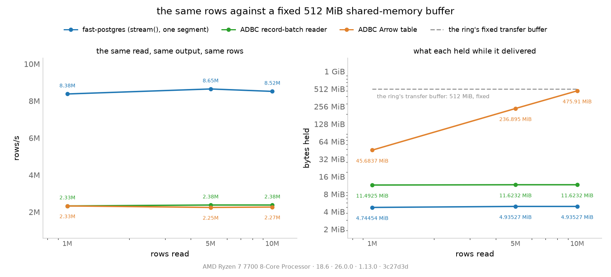

# fastpostgres against Arrow under one memory budget

The [read benchmark](../README.md#measured) asks which transport hands over the
same rows faster. This one asks the question that decides whether either can be
used at all: **what does each side hold while it delivers them?** The ring's
transfer buffer is fixed and reported, the Arrow side is asked for its own
accounting, and the same rows and the same output run through both.

The measurement is `just arrow-memory-bench`, the record is
[`fastpostgres-vs-arrow-memory.log`](fastpostgres-vs-arrow-memory.log), and the
rival is the same one the read benchmark uses: ADBC's PostgreSQL driver, whose
results arrive as Arrow record batches, consumed with pyarrow.

(`just arrow-memory-charts` renders it from the log.)

## What is being compared

| player | the path | what it holds |
|---|---|---|
| `ring` | `stream()`'s columnar batches, summed in place with numpy | one data segment of **512 MiB**, fixed by `FASTPOSTGRES_SEGMENT_BYTES` and identical at every row count, plus the fixed 8 MiB control ring — with one 100k-row batch in flight at a time |
| `arrow-batch` | ADBC's `fetch_record_batch()`, `pyarrow.compute.sum` per batch | one Arrow record batch at a time, sized by the driver's read stream (253,722 rows here) |
| `arrow-table` | ADBC's `fetch_arrow_table()`, `pyarrow.compute.sum` over the result | the whole result, in Arrow buffers |

All three read the same six columns and return the same number — the sum of
`price` over the same rows — and the harness compares the three sums, so a faster
path that returned something else fails the run. The ring's evidence line is read
from the segment the worker itself created (a cell whose segment is not the
asked-for 512 MiB fails the run as well), and `stream()` has no socket to fall
back to: a ring cell that ran is a ring cell. One player per process, one at a
time, 1M / 5M / 10M rows, three reps each — none of these three players builds
per-row Python objects, so the read benchmark's one-rep-past-1M rule (its object
arena) does not apply.

## The numbers

| rows/s | 1M | 5M | 10M |
|---|---|---|---|
| `ring` (`stream()` + numpy) | **8.38M** | **8.65M** | **8.52M** |
| `arrow-batch` (reader + `compute`) | 2.33M | 2.38M | 2.38M |
| `arrow-table` (table + `compute`) | 2.33M | 2.25M | 2.27M |

| bytes held while the read runs | 1M | 5M | 10M |
|---|---|---|---|
| the ring's transfer buffer (fixed for every read) | 512 MiB | 512 MiB | 512 MiB |
| the ring's batch in flight (100k rows) | 4.7 MiB | 4.9 MiB | 4.9 MiB |
| the reader's largest batch (253,722 rows) | 11.5 MiB | 11.6 MiB | 11.6 MiB |
| the table path's result | 45.7 MiB | 236.9 MiB | **475.9 MiB** |

| peak RSS of the reader's own process | 1M | 5M | 10M |
|---|---|---|---|
| `ring` | 144 MiB | 142 MiB | 143 MiB |
| `arrow-batch` | 166 MiB | 171 MiB | 170 MiB |
| `arrow-table` | 189 MiB | 391 MiB | 649 MiB |

## What it says

- **The ring pays the same bytes for 1M rows and for 10M.** Its segment is
  512 MiB in every cell of the log and the batch it pulls is ~4.8 MiB per 100k
  rows, so the process's peak RSS is flat at ~143 MiB: nothing in the read grows
  with the result. The buffer is *reserved*, not resident (see below), but the
  reservation is what makes the read one fixed window instead of a growing one.
- **Arrow's streaming path is bounded too — at the driver's batch size.** The
  record-batch reader holds one batch of 253,722 rows (~11.6 MiB) whatever the
  result's size, and its RSS moves 166 → 170 MiB across a 10× range of rows.
- **Arrow's table path pays the result's size.** 45.7 MiB at 1M rows, 236.9 MiB
  at 5M, 475.9 MiB at 10M — and its process's peak RSS grows with it (189 → 391 →
  649 MiB). At 10M rows the table holds ~476 MiB *at once*: the same order as the
  512 MiB the ring reserves for the whole stream and uses ~5 MiB of at a time,
  and one size up it would need more buffer than the ring's budget.
- **Per row, the two columnar forms cost about the same bytes** — 4.7–4.9 MiB
  per 100k rows on the ring against 4.75–4.8 MiB per 100k rows through ADBC's
  batches, each measured by its own accounting. What this benchmark prices is not
  the format's density but *when* the bytes are held.
- **The ranking does not move with the row count.** The ring is 3.6–3.8× the two
  Arrow paths here, the same 3.6–3.8× the read benchmark publishes at its own
  defaults: fixing the ring's buffer at 512 MiB, a quarter of its default, changes
  nothing about who wins.

## What this does not say

- One host, one shape (`bench`), three sizes, three reps, one run; the spread is
  printed per row in the log (±0.2–1.7%).
- The 512 MiB is **reserved, not resident**: the segment is `ftruncate`d and
  `mmap`'d, and tmpfs allocates only the pages that get written, so what a read
  actually costs in RAM is the batch in flight plus whatever the last batches left
  mapped. Do not read "512 MiB" as 512 MiB of RAM burned — read it as "the read
  never needs a buffer larger than this, whatever the result's size".
- RSS is a footprint reading, not a budget: the interpreter, numpy, pyarrow and
  the driver are in it, and shared/mapped pages are counted per process (the
  caveat is spelled out in [`CODEC-TRANSPORT.md`](CODEC-TRANSPORT.md)).
- The Arrow batch size is the driver's own choice. `adbc.postgresql.batch_size_hint_bytes`
  is the knob — a *statement* option (it is refused as a database option), so a
  harness that wants a different batch size must set it on the statement, and a
  smaller hint moves both the bytes the reader holds and its per-batch overhead.
- The sums agree to float rounding, not exactly: numpy accumulates batch by batch
  and `pyarrow.compute` sums the whole column, so the orders differ. The harness
  allows a 1e-6 relative difference and the log prints the ring's sum, which all
  three must match.
- `stream()` reads the columnar frame. The DBAPI's tuple path (`fetchall`) uses
  two alternating data segments and would split the same budget in half; that path
  belongs to the read benchmark, not this one.
- The two byte counts are each stack's own: the ring's is the column regions it
  maps (data plus null bitmap) and Arrow's is the record batch's buffers (values,
  offsets, validity). They are close enough here to compare per row, not
  identical in what they include.
