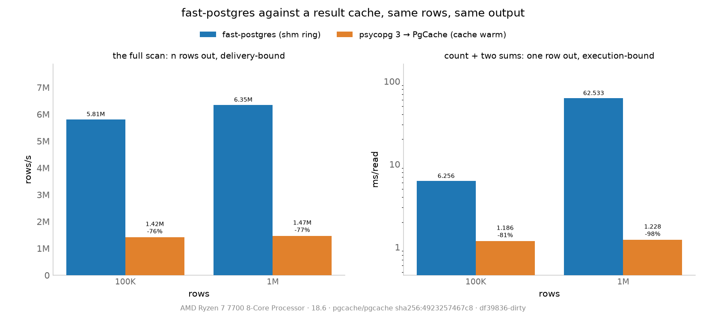

# fastpostgres against a result cache: what each one buys

Written for the reader who asks "why not just cache the result?". The measurement
is `just pgcache-bench`, the record is
[`fastpostgres-vs-pgcache.log`](fastpostgres-vs-pgcache.log), and the rival is
[PgCache](https://www.pgcache.com): a wire-compatible proxy that caches query
results and keeps them fresh from the origin's logical replication stream.

The short answer is that they optimize different stages, so the ranking depends
on the shape of the result — and on this machine, with this data, one of them
loses to *not caching at all*.



(`just pgcache-charts` renders it from the log.)

## What is being compared

Two clients read the same rows, from the same table, in one container:

| player | path |
|---|---|
| `fastpostgres` | the shm ring: the executor's tuples written into `/dev/shm`, read in place |
| `pgcache` | `psycopg 3` to the PgCache proxy at `127.0.0.1:6432`, which caches what it can |

Both return Python tuples, both run autocommit, each is measured in a process of
its own, one at a time. The driver inside the cache player is plumbing, not a
player: the rival the cache is measured against is the ring.

Three workloads, because one would hide the answer:

- **large** — `SELECT id, sku, name, price, stock, active FROM fp_bench_rows`:
  the same n rows the ADBC comparison uses. Delivery-bound.
- **small** — `SELECT count(*), sum(price), sum(stock) FROM fp_bench_rows`: n rows
  read, one row out. Execution-bound, and materialized by PgCache.
- **through** — the same six columns through a view. PgCache forwards views, so
  this is the proxy hop with no cache in front of it.

Every player checks the same thing before its numbers are trusted: the result's
row count and the sums over its columns, compared across players. A cached result
set is not guaranteed to arrive in the origin's scan order, so the check is on the
multiset. The log prints `ok` or `MISMATCH`; the run exits non-zero on a mismatch.

## How the cache is measured fairly

- **The proxy is not a neighbour during the rival measurement.** `fastpostgres`
  is timed with the proxy container stopped.
- **It starts after the table exists.** PgCache resets its cache on startup, so
  every run's cache can only ever contain rows from that run's table.
- **Hits are proven, not assumed.** The player reads the proxy's own
  `pgcache_queries_cache_hit` / `_miss` counters around the warm phase and around
  the timed reps, and prints them under the row. Every headline number is a run
  where the reps recorded `0 miss`.
- **The warm phase is honest about what it costs.** A miss forwards to the origin
  and starts a population; the entry appears later, and can be invalidated again
  by replication events already in flight for the table that was just built. So
  the warm phase reads until the proxy serves a hit *and keeps serving it* for
  2 seconds, and reports how many reads and how long that took. Waiting for the
  cache to settle is the state a cache is in between changes; what a transient
  costs is the **fill** rows, not the headline.
- **The fill is measured too.** After a proxy restart, one read per workload is
  timed as a miss: what a cold cache costs, against the same read on the ring.

## The numbers

Rows/s for the two row-returning workloads, ms/read for the aggregate, median of
3 reps (1 above 1M rows), 100K and 1M rows, `bench` shape:

| 100K | fastpostgres | pgcache (hit) |
|---|---|---|
| large, rows/s | **5.81M** | 1.42M |
| small, ms/read | 6.256 | **1.186** |
| through, rows/s | **5.74M** | 1.87M |

| 1M | fastpostgres | pgcache (hit) |
|---|---|---|
| large, rows/s | **6.35M** | 1.47M |
| small, ms/read | 62.533 | **1.228** |
| through, rows/s | **5.86M** | 1.80M |

The two regimes, in one line each:

- **A large result does not want a cache.** A cache hit still ships the cached
  rows from the cache database through the proxy to the client, and the client
  still parses them and builds the same Python tuples; the ring never crosses a
  socket. At 1M rows the hit is **1.47M rows/s against 6.35M on the ring** — 4.3×
  slower — and it costs what the cold fill costs (680 ms against the 620.8 ms
  below): the cache pays to ship the rows either way, so on a large result it is
  slower than not caching at all. Forwarding the same rows uncached is faster
  still: 1.80M rows/s.
- **A small expensive result wants the cache and nothing else.** The aggregate
  hit is a materialized result: **1.228 ms against 62.533 ms** on the ring at 1M
  rows, and the gap widens with n — 5.3× at 100K. This is the workload a result
  cache exists for, and no transport fixes it — the executor is the cost.

## What the cache costs

| 1M rows, one read | pgcache | fastpostgres |
|---|---|---|
| fill, large (cold cache) | 620.820 ms | **157.565 ms** |
| fill, small (cold cache) | 162.371 ms | **62.533 ms** |
| warm-up to a stable hit, large | 17 reads / 21.9 s | — |
| warm-up to a stable hit, small | 5 reads / 2.1 s | — |

- **A cold miss on the aggregate costs ~2.6× the ring read** at 1M rows — 30× at
  100K: the proxy forwards *and* populates the cache, so the first reader pays
  for both.
- **The large workload's cache never pays back.** Its fill (620.8 ms) is already
  at its hit (~680 ms), and both are ~4× the ring.
- **Populating 1M rows took 17 reads and 21.9 s** before the hit held still —
  population plus the replication stream settling on a table that was just built.
- **The pass-through tax is the hop and the socket.** Views are never cached:
  1.80M rows/s against 5.86M on the ring at 1M rows.

## What this does not say

- One host, one container, one PostgreSQL 18, one shape family, one PgCache
  version, defaults otherwise (`pgcache/pgcache` pinned by image id in the log).
  Not a claim about PgCache in production, and not about other cache shapes.
- The proxy's own processes run on the same 16-thread box as the clients, as any
  single-host comparison must; the log carries the machine.
- The proxy is measured over loopback TCP because that is its only delivery path:
  PgCache has no shared-memory or unix-socket transport (its shared memory is the
  extension's invalidation index in the cache PostgreSQL, not a way to hand bytes
  to the client). The repo's own transport matrix prices the best case a socket
  could reach: 11.18 GB/s over shm against 6.93 GB/s over a unix socket.
- No plain-socket baseline: the cache is measured against the ring, which is the
  fastest read this host has, not against a driver.
- **The cache is client-dependent.** With this pinned image, an Arrow client
  (ADBC's PostgreSQL driver: `fetch_arrow_table` or `fetchall`) is never cached:
  every query is counted `unsupported`/`uncacheable` by the proxy and forwarded —
  0 hits over 30 s of repeated 1M-row reads — and the forwarded read runs 8.6×
  slower than the same ADBC read against the origin (3647.5 ms against 426.6 ms).
  The cache player here uses psycopg 3, whose statements the proxy registers and
  serves, parameterized or not.
- No writes, no invalidation-under-load, no read-your-own-writes, no CDC lag
  measurement. Those are the cache's risks, and they are its own to document; this
  log measures the reads.
- The 1M-row numbers are 3 reps; the run is not repeated across boots the way
  `METHODOLOGY.md` characterizes the ADBC comparison, so treat these as one run
  family with the spread printed per row.

## What follows from it

The two are not competitors, and the benchmark says so in both directions:

| your read is | reach for |
|---|---|
| the same expensive aggregate, asked again and again, staleness tolerated | a result cache — no transport closes a 50× execution gap |
| large results, or distinct/first-time reads, or freshness required | the shm ring — a cache hit on a large result is slower than not caching, and a cache does nothing for a query it has not seen |
| both | they compose in principle (cache the execution, deliver over shm) but not in practice today: a network-positioned proxy sits in the wrong place for a same-host shared segment |

Reproduce with:

```bash
just pgcache-bench            # 100K and 1M, writes nothing; redirect for a log
just pgcache-bench --quick    # 1K rows, one rep: a smoke run
just pgcache-bench 100000 1000000 10000000
```
